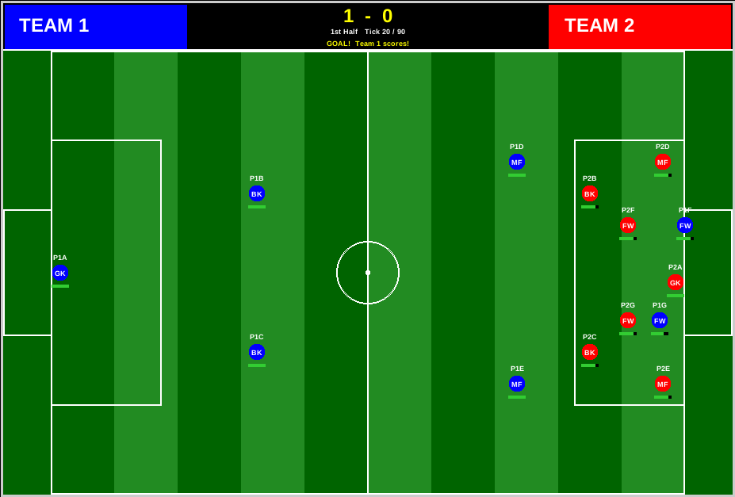
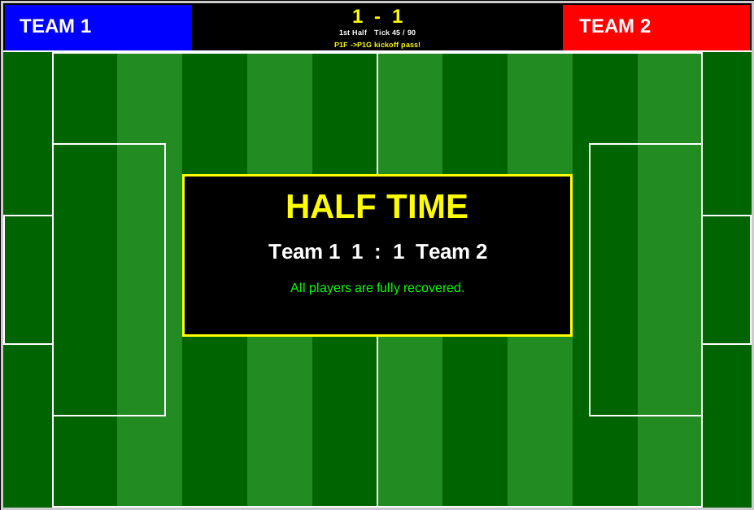
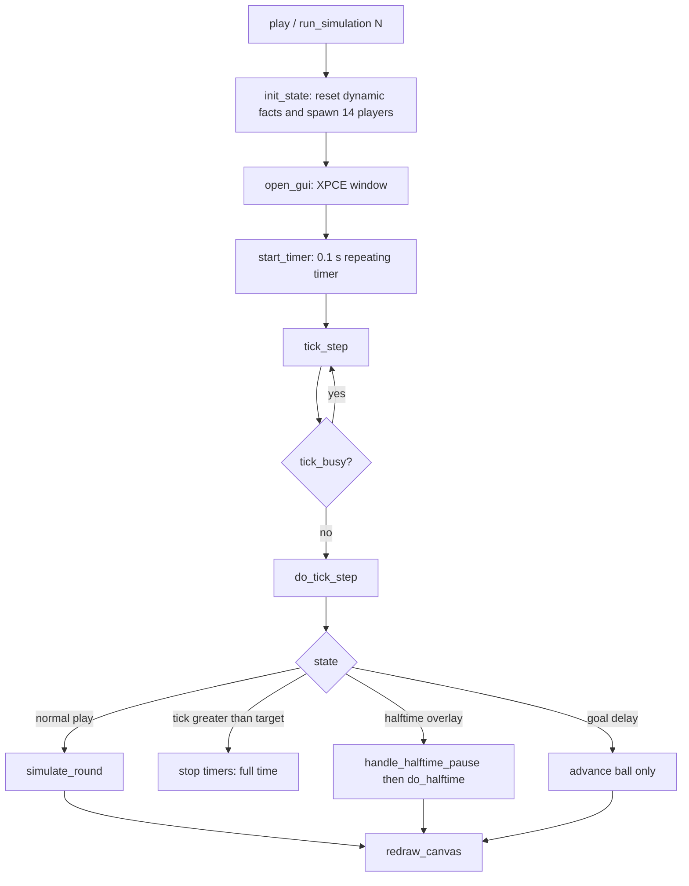
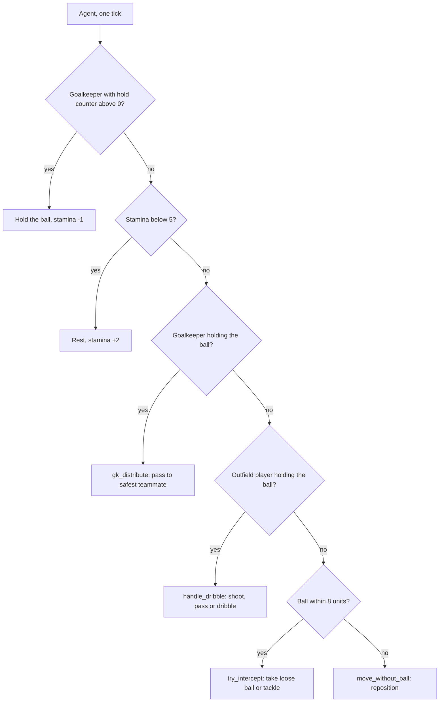
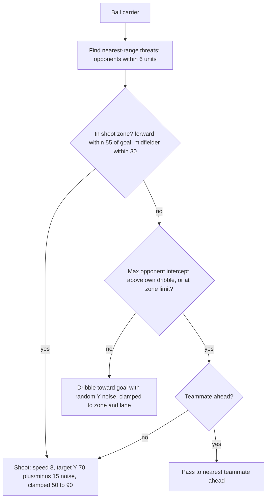
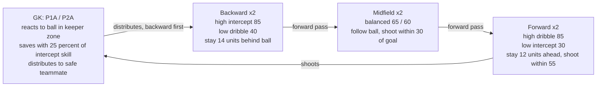

# AI RoboCup - Rule-Based Multi-Agent Football Simulation in Prolog

A 7-vs-7 RoboCup-style football match simulator written in **SWI-Prolog**, with a live **XPCE** GUI. Every player is a rule-based agent driven by a role-specific priority decision tree. The match runs from kickoff through halftime (with a side switch) to full time, and shows the score, action commentary and per-player stamina on screen.

> Repository name `2190514_AI_Robocup` suggests a university course project (course code 2190514). The course name is not stated anywhere in the repo.

The whole program is one source file, `robocup3` (a SWI-Prolog source file with no extension, 1,179 lines).

## Screenshots

Captured by running the program headless under Xvfb (see [How to run](#how-to-run)).

| Match in play (goal just scored) | Halftime overlay | End of match (2nd half) |
|---|---|---|
|  |  |  |

## Features

- 14 agents (2 teams x 7: 1 goalkeeper, 2 defenders, 2 midfielders, 2 forwards each), all simulated in Prolog.
- Four roles with different skill profiles: dribbling, interception, movement zone (X-range) and support offset.
- Per-tick priority decision logic for each agent (goalkeeper hold, stamina recovery, goalkeeper distribution, dribble/shoot/pass, tackle/intercept, off-ball positioning).
- Probabilistic events: tackle success depends on tackler interception vs. carrier dribbling; goalkeeper save probability depends on the goalkeeper's interception skill.
- Stamina model: actions drain stamina, resting agents recover, exhausted agents (< 5) rest.
- Two halves with a halftime pause, full stamina restore, mirrored positions and side switch; the opposing team takes the second-half kickoff.
- Goals, saves, goal kicks and restarts after goals (1.5 s delay).
- GUI: striped pitch, scoreboard, half/tick counter, live action message, role/name labels, ball-carrier marker, colour-coded stamina bars.
- Match length is configurable: `run_simulation(N)` with N from 1 to 90 ticks.

## Tech stack

| Item | Detail |
|---|---|
| Language | Prolog (SWI-Prolog) |
| GUI | XPCE (`library(pce)`) |
| Other libraries | `library(random)`, `library(lists)` |
| Paradigm | Logic programming; world state held in dynamic facts (`assertz`/`retract`) |

## Architecture

The simulator is a single-threaded, timer-driven loop. An XPCE timer fires `tick_step/0` every 0.1 s. Each tick runs the game logic (one pass over all 14 agents) and then redraws the canvas.



World state is stored as dynamic Prolog facts (22 `:- dynamic` declarations), for example:

- `player(Name, Team, Role, position(X,Y), Stamina, Speed, Dribble, Intercept)`
- `ball(position(X,Y), Controller)` (controller is `null` when the ball is free) and `ball_velocity(VX,VY)`
- `score/2`, `round_counter/1`, `target_tick/1`, `half/1`, `kickoff_team/1`, `gk_hold_count/2`, `home_y/2`
- GUI facts: `gui_frame/1`, `gui_canvas/1`, `sim_timer/1`, `delay_timer/1`, `live_gfx/1`

The pitch is a 200 x 140 unit coordinate space, drawn at 4 px per unit. The goal mouth is Y in [50, 90].

Code sections in the file: dynamic facts, static config, helpers, side-switch helpers, entry points, initialisation, GUI setup, tick loop, halftime flow, one-tick gameplay, player decision logic, goalkeeper helpers, attack logic, intercepts/tackles, off-ball movement, goal checking/restarts, and drawing (field, header, players, ball, halftime overlay).

## How it works

### One gameplay tick (`simulate_round/0`)

1. Perform kickoff if not yet done (`do_kickoff`): the forward nearest the centre spot kicks off and passes to the next-nearest forward.
2. Goalkeepers react to the ball (`gk_respond_to_ball`): track the ball's Y (max 3 units/tick) when it is in the keeper zone, otherwise drift back to home Y (max 2 units/tick).
3. Advance a free-rolling ball by its velocity.
4. Process every player once with `process_player/8`.
5. Check whether the ball crossed an end line (`check_goal`).

### Agent decision priority (`process_player/8`)

Clauses are tried top-down, first match wins.



### Ball carrier logic (`handle_dribble/7`)



### Roles and strategy

| Role | Base dribble | Base intercept | Speed | X zone (team1 attacking right) | Support offset (team1) |
|---|---|---|---|---|---|
| Goalkeeper | 20 | 80 | 0 | 0-12 | n/a (own logic) |
| Backward (defender) | 40 | 85 | 45 | 0-120 | -14 (stays behind ball, floor X 30) |
| Midfield | 65 | 60 | 65 | 0-150 | 0 |
| Forward | 85 | 30 | 85 | 0-200 | +12 (stays ahead of ball) |

(Team 2 mirrors these zones and offsets. The speed value is the third-last argument of `spawn_player/6`; goalkeepers have speed 0 and move by dedicated keeper logic.)



Other mechanics:

- **Tackle**: chance = clamp(50 + tackler_intercept - owner_dribble, 10, 90) percent. A goalkeeper holding the ball after a save cannot be tackled.
- **Save**: save threshold = round(GK intercept x 0.25) percent (20 percent with the default GK intercept of 80); otherwise it is a goal.
- **Goalkeeper distribution**: teammates with no opponent within 15 units are "safe"; preference order backward, midfield, forward; if none are safe, the nearest teammate is used.
- **Off-ball movement**: target X = ball X + role offset, clamped to the role zone; Y drifts to the player's home Y within a 25-unit lane; players outside their zone relative to the ball recover stamina instead.
- **Halftime**: triggered at tick 45 when the match is longer than 45 ticks; shows a 20-tick overlay, restores stamina, mirrors positions, resets the round counter to 46 and gives team 2 the kickoff.
- **Missed shot**: ball crossing the end line outside Y 50-90 gives a goal kick to the defending goalkeeper.

## Results / outputs

- The GUI window shows the live score, half, tick counter, current action text and stamina bars (screenshots above).
- Randomness (`random/3`) means every match differs. In one captured headless run (driver described below, not a benchmark) the match finished 2-2, with a halftime score of 1-1.

## How to run

Requires SWI-Prolog with XPCE (on Debian/Ubuntu: `apt-get install swi-prolog-x`) and a display.

```bash
swipl robocup3
?- play.                 % full 90-tick match
?- run_simulation(30).   % shorter match, N between 1 and 90
```

Notes:

- The file has no extension and CRLF line endings; `swipl robocup3` or `consult('robocup3').` both work. Setting `LANG=C.UTF-8` avoids "Illegal multibyte sequence" warnings caused by the em-dash in the goal-kick message and in comments.
- Headless (for screenshots/CI): `xvfb-run -a swipl robocup3`, then capture the X display with e.g. ImageMagick `import -window root out.png`. The screenshots in `docs/images/` were produced this way by stepping `tick_step/0` from a small driver script and capturing at selected ticks.
- Verified: the program loads and runs end-to-end under SWI-Prolog with XPCE on Linux (Xvfb). Timing note: the XPCE timer needs the interactive toplevel/event loop; scripted runs should call `tick_step/0` directly.

## Repository structure

```
.
├── robocup3            # entire simulator (SWI-Prolog, 1,179 lines)
├── README.md
└── docs/images/        # screenshots captured from a real run
    ├── match-in-play.png
    ├── halftime-overlay.png
    └── match-end.png
```

## Project Facts (for resume)


- **Course**: 2190514 – Artificial Intelligence
- **Language / libraries**: SWI-Prolog; XPCE (`library(pce)`) for GUI and timers; `library(random)`; `library(lists)`. No external dependencies. This is a custom Prolog simulation, not the official RoboCup `rcssserver`.
- **Size**: 1 source file, 1,179 lines (~38 KB); about 54 distinct predicate names defined, 22 dynamic fact declarations, 14 agents (7 per team), 4 roles, 23 numbered code sections.
- **Key features**: see Features. Two-half match with halftime side switch, stamina model, tackles and saves with probabilities, GUI with live commentary and stamina bars.
- **Algorithms / design**: rule-based agents with a priority-ordered decision tree (Prolog clause ordering with cuts); role-based skill parameters and movement zones; distance-based threat detection (6 units), pass-target selection (nearest teammate ahead), safe-pass filtering for the keeper (no opponent within 15 units); probabilistic tackle and save resolution; velocity-based ball model for shots; dynamic-fact world state; timer-driven game loop with a re-entrancy guard (`tick_busy`) and `catch`-based fault isolation (`safe/1`) so one failing agent cannot crash the match; side-switch helper predicates (`effective_*`) to reuse logic for both halves.
- **Measurable numbers (from code)**: pitch 200 x 140 units; match 90 ticks max, halftime at tick 45; 0.1 s per tick; tackle chance 10-90 percent; GK save threshold 20 percent at default skill; shot speed 8 units/tick; goal-kick/restart logic as above. No performance or win-rate numbers exist.
- **Hard problems and how solved (evident in code)**: avoiding overlapping timer ticks (busy flag); not crashing on predicate failure (`safe/1`, `catch`); reusing attack/defence logic after the side switch (`switched_team/2` and `effective_*` wrappers); keeping random movement inside role zones and lanes (`clamp/4`, `y_lane/3`); flicker-free redraw by tracking and freeing each frame's graphics (`live_gfx`).
- **Outcome**: working, runnable simulator verified in this session.
