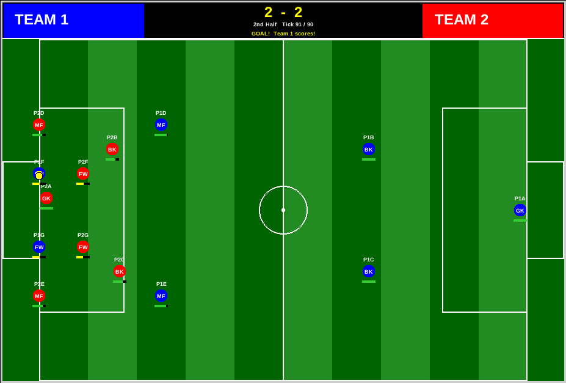
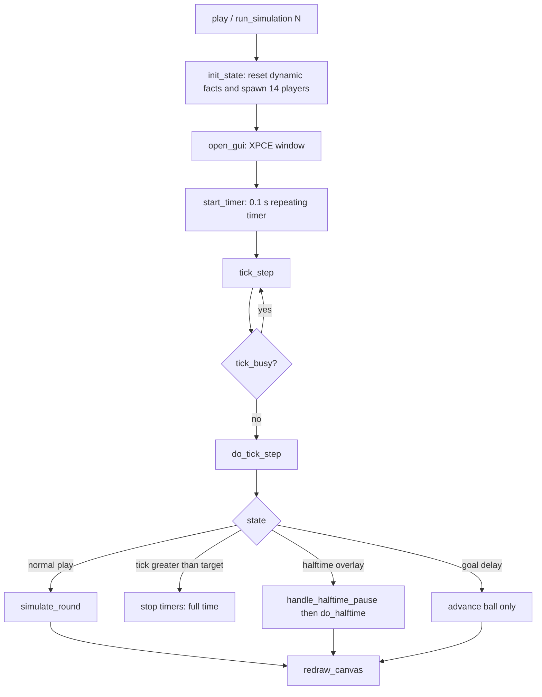
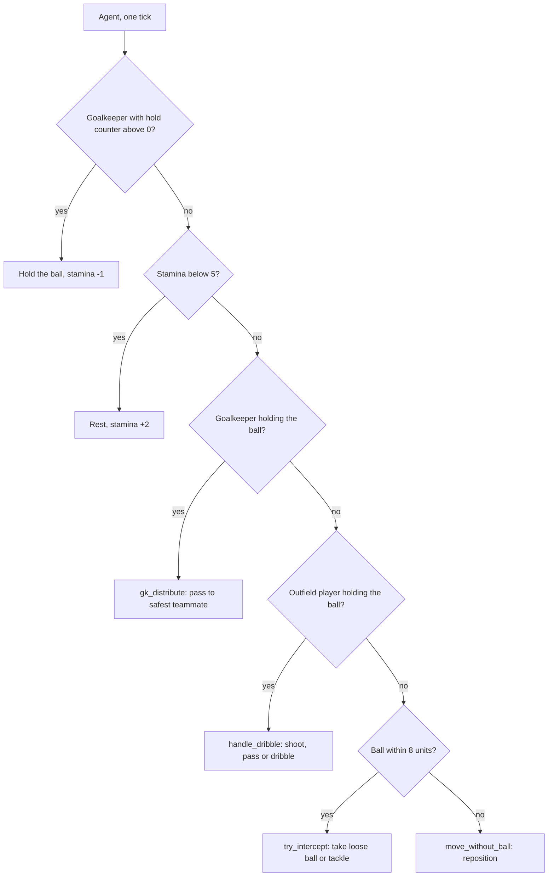
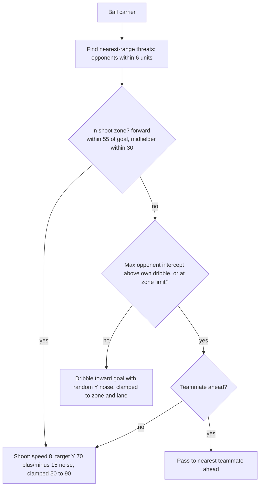
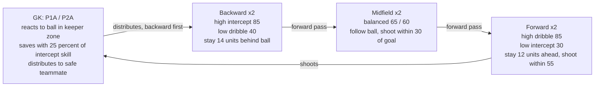

# AI RoboCup - Rule-Based Multi-Agent Football in Prolog

A 7-vs-7 RoboCup-style football match simulator written in **SWI-Prolog**, with a live **XPCE** GUI. Every player is a rule-based agent that decides what to do from a priority list based on its role. A match goes from kickoff to halftime (teams switch sides) and on to full time, with the score, a running commentary line and each player's stamina shown on screen.

I made this for the 2190514 Artificial Intelligence course. It's my own simulator written from scratch, not the official RoboCup `rcssserver`.

Everything lives in one file, `robocup3` (a SWI-Prolog source file with no extension, 1,179 lines).

## Screenshots

Taken by running the program headless under Xvfb (see [How to run](#how-to-run)).

| Match in play (goal just scored) | Halftime overlay | End of match (2nd half) |
|---|---|---|
|  |  |  |

## Features

- 14 agents (two teams of 7: 1 goalkeeper, 2 defenders, 2 midfielders and 2 forwards each), all running in Prolog.
- Four roles with their own skills: dribbling, interception, how far up and down the pitch they roam, and where they stand relative to the ball.
- Every tick each agent picks an action by priority: goalkeeper holds the ball, recover stamina, goalkeeper distributes, dribble/shoot/pass, tackle/intercept, or move into position.
- Random outcomes: whether a tackle works depends on the tackler's interception against the carrier's dribbling, and the goalkeeper's chance to save depends on their interception skill.
- Stamina: actions use it up, resting brings it back, and anyone below 5 has to rest.
- Two halves with a halftime break. Stamina is refilled, positions are mirrored, the teams switch sides and the other team kicks off.
- Goals, saves, goal kicks and restarts after a goal (1.5 s delay).
- GUI with a striped pitch, scoreboard, half and tick counter, live action text, player name/role labels, a marker on whoever has the ball, and coloured stamina bars.
- You choose how long the match is: `run_simulation(N)` with N from 1 to 90 ticks.

## Tech stack

| Item | Detail |
|---|---|
| Language | Prolog (SWI-Prolog) |
| GUI | XPCE (`library(pce)`) |
| Other libraries | `library(random)`, `library(lists)` |
| Style | Logic programming; the game state is kept in dynamic facts (`assertz`/`retract`) |

## Architecture

It's a single-threaded loop driven by a timer. An XPCE timer calls `tick_step/0` every 0.1 s. Each tick runs the game logic once for all 14 agents and then redraws the canvas.



The game state is all dynamic Prolog facts (22 `:- dynamic` declarations), for example:

- `player(Name, Team, Role, position(X,Y), Stamina, Speed, Dribble, Intercept)`
- `ball(position(X,Y), Controller)` (controller is `null` when nobody has the ball) and `ball_velocity(VX,VY)`
- `score/2`, `round_counter/1`, `target_tick/1`, `half/1`, `kickoff_team/1`, `gk_hold_count/2`, `home_y/2`
- GUI facts: `gui_frame/1`, `gui_canvas/1`, `sim_timer/1`, `delay_timer/1`, `live_gfx/1`

The pitch is 200 x 140 units, drawn at 4 px per unit. The goal mouth is Y from 50 to 90.

The file is split into sections: dynamic facts, static config, helpers, side-switch helpers, entry points, initialisation, GUI setup, tick loop, halftime, one gameplay tick, player decisions, goalkeeper helpers, attacking, intercepts and tackles, off-ball movement, goals and restarts, and drawing (field, header, players, ball, halftime overlay).

## How it works

### One gameplay tick (`simulate_round/0`)

1. Kick off if it hasn't happened yet (`do_kickoff`). The forward closest to the centre spot kicks off and passes to the next-closest forward.
2. Goalkeepers react to the ball (`gk_respond_to_ball`). When it's in their zone they follow its Y position (up to 3 units per tick), otherwise they drift back home (up to 2 units per tick).
3. If nobody has the ball, it keeps rolling with its velocity.
4. Every player gets one turn through `process_player/8`.
5. Check if the ball went over an end line (`check_goal`).

### How an agent decides (`process_player/8`)

The clauses are tried from top to bottom and the first one that matches wins.



### What the player with the ball does (`handle_dribble/7`)



### Roles

| Role | Base dribble | Base intercept | Speed | X zone (team 1 attacking right) | Offset from ball (team 1) |
|---|---|---|---|---|---|
| Goalkeeper | 20 | 80 | 0 | 0-12 | n/a (own logic) |
| Backward (defender) | 40 | 85 | 45 | 0-120 | -14 (stays behind the ball, never below X 30) |
| Midfield | 65 | 60 | 65 | 0-150 | 0 |
| Forward | 85 | 30 | 85 | 0-200 | +12 (stays ahead of the ball) |

Team 2 uses the same zones and offsets, just mirrored. Speed is the third-last argument of `spawn_player/6`. Goalkeepers have speed 0 because they move with their own keeper logic.



The other rules:

- **Tackles**: the chance is clamp(50 + tackler_intercept - carrier_dribble, 10, 90) percent. A goalkeeper holding the ball after a save can't be tackled.
- **Saves**: the keeper saves with a chance of round(GK intercept x 0.25) percent, which is 20 percent with the default intercept of 80. Otherwise it's a goal.
- **Goalkeeper passes**: a teammate is "safe" if no opponent is within 15 units. The keeper prefers defenders, then midfielders, then forwards. If nobody is safe, it goes to the closest teammate.
- **Moving without the ball**: the target X is the ball's X plus the role offset, kept inside the role's zone. Y drifts back towards the player's home Y within a 25-unit lane. Players who are out of their zone compared to the ball rest instead.
- **Halftime**: happens at tick 45 if the match is longer than 45 ticks. It shows an overlay for 20 ticks, refills stamina, mirrors positions, sets the counter to 46 and gives team 2 the kickoff.
- **Missed shots**: if the ball goes over the end line outside Y 50-90, the defending keeper gets a goal kick.

## What you see

- The window shows the live score, which half it is, the tick counter, what's happening right now, and stamina bars (see the screenshots).
- Because of `random/3`, no two matches are the same. In the run used for the screenshots it ended 2-2, and it was 1-1 at halftime.

## How to run

You need SWI-Prolog with XPCE (on Debian/Ubuntu: `apt-get install swi-prolog-x`) and a display.

```bash
swipl robocup3
?- play.                 % full 90-tick match
?- run_simulation(30).   % shorter match, N between 1 and 90
```

A few notes:

- The file has no extension and uses CRLF line endings. Both `swipl robocup3` and `consult('robocup3').` work. Set `LANG=C.UTF-8` to get rid of "Illegal multibyte sequence" warnings, which come from the em-dash in the goal-kick message and in some comments.
- To run without a screen (for screenshots), use `xvfb-run -a swipl robocup3` and grab the display with something like ImageMagick `import -window root out.png`. That's how the images in `docs/images/` were made: a small script stepped `tick_step/0` and took a capture at a few ticks.
- The XPCE timer needs the interactive toplevel or event loop. If you script it, call `tick_step/0` yourself.

## Repository structure

```
.
├── robocup3            # the whole simulator (SWI-Prolog, 1,179 lines)
├── README.md
└── docs/images/        # screenshots from a real run
    ├── match-in-play.png
    ├── halftime-overlay.png
    └── match-end.png
```

## Things that were tricky

- Timer ticks overlapping each other. A `tick_busy` flag stops a new tick from starting while the last one is still running.
- One agent failing shouldn't crash the whole match, so every step is wrapped in `safe/1` (built on `catch`).
- Reusing the same attack and defence logic after the teams switch sides. `switched_team/2` and the `effective_*` helpers handle that.
- Keeping random movement inside each role's zone and lane, using `clamp/4` and `y_lane/3`.
- Redrawing without flicker by keeping track of each frame's graphics (`live_gfx`) and freeing them before the next frame.
